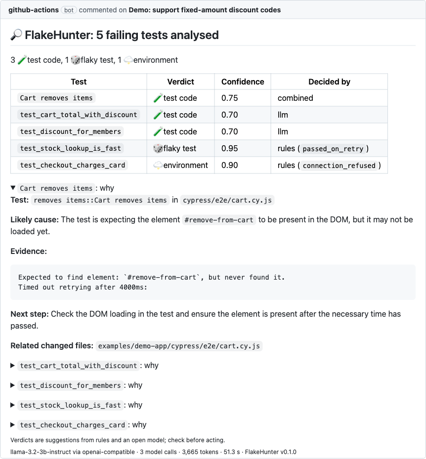
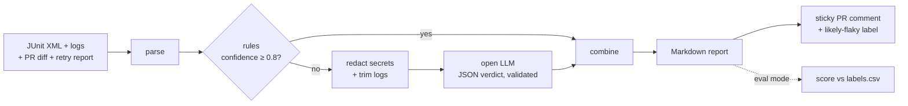

# FlakeHunter

[](https://github.com/andrewlesley10/flakeHunter/actions/workflows/ci.yml)
[](LICENSE)

**A GitHub Action that reads a failed CI run, decides why each test failed, and explains it on the pull request: product bug, flaky test, environment problem, or a bug in the test itself.** Free to run: an open model on the GitHub runner, no API key.

When CI goes red, engineers lose hours working out whether the code is broken or the test is unreliable, and teams that see too many false alarms start ignoring red builds. I did this triage by hand every day on a Selenium regression suite and a Cypress suite. FlakeHunter does the first pass in about a minute.

**▶ Live demo:** [a PR that fails on purpose, with FlakeHunter's real comment](https://github.com/andrewlesley10/flakeHunter/pull/10)



## Quick start

Add one step after your tests. Any runner that writes JUnit XML works: pytest, Cypress, Jest, Maven Surefire (Selenium/JUnit) and similar.

```yaml
permissions: { contents: read, pull-requests: write }
# ... your test steps, e.g. pytest --junitxml=reports/junit.xml
      - if: failure()
        uses: andrewlesley10/flakeHunter@v1
        with: { junit: "reports/*.xml" }
```

A complete workflow is in [docs/example-workflow.yml](docs/example-workflow.yml). FlakeHunter posts **one** comment per workflow job, edits it on every run, and adds a `likely-flaky` label when it finds a flaky test.

## How it works



- **Rules first.** Patterns like `Connection refused`, DNS errors, out-of-memory, "passed on re-run" and "element not found in a test file this PR changed" settle the obvious failures for free, instantly, and with the exact matching line as evidence.
- **An open model second.** Anything the rules can't settle goes to Llama 3.2 3B with the rule's hint, the PR's changed files and the trimmed, redacted log. It must answer with JSON that passes a pydantic schema. Invalid answers get one repair attempt, then a deterministic fallback.
- **Combine.** Agreement raises confidence; disagreement lowers it and is shown in the comment. See [DECISIONS 008](DECISIONS.md#008--how-rules-and-the-llm-are-combined).

## Categories

| Category | Meaning | Example |
|---|---|---|
| 🐛 `product_bug` | The application is wrong; the test caught it. | `assert 90.0 == 81.0` after the PR changed pricing |
| 🎲 `flaky_test` | Same code, different result: timing, ordering, randomness. | Failed, then passed on re-run |
| 🌩️ `environment` | Infrastructure was broken: network, DNS, a service, memory, disk. | `ECONNREFUSED 127.0.0.1:5432` |
| 🧪 `test_code` | The test itself is wrong: stale selector, wrong expectation, broken fixture. | `Expected to find element: #buy-btn` after a rename |
| ❓ `unknown` | Not enough evidence. An honest answer, not an error. | A bare `AssertionError` |

Full definitions and precedence: [docs/categories.md](docs/categories.md).

## Results

On **125 labelled failures** (91 real failures from a scenario suite with known causes, 4 from the demo PR, and 30 real Travis build logs from LogChunks), with Llama 3.2 3B at temperature 0:

| Mode | Accuracy | Macro F1 | Share with confidence ≥ 0.8 | Accuracy at ≥ 0.8 | Tokens / failure |
|---|---|---|---|---|---|
| Rules only | 31% | 0.33 | 17% | 100% | 0 |
| Model only | 52% | 0.38 | 66% | 50% | 929 |
| **Rules + model (FlakeHunter)** | **62%** | **0.55** | 17% | **100%** | 767 |

- **Rules first pays off:** +10 points over the model alone, with 17% fewer tokens. The rules settle 17% of failures for free, and every one of those was right.
- **A high-confidence verdict is trustworthy; a model-only verdict is a lead, not an answer.** The 3B model's own confidence was poorly calibrated, so FlakeHunter caps it at 0.7.
- **Real build logs are much harder** (33% on LogChunks vs 69% on the scenarios). See the per-source breakdown.
- About 5 s per failure that reaches the model on a laptop; about 15–40 s on a GitHub runner’s CPU.

Full results, per-category precision and recall, the confusion matrix, log-trimming recall and an error analysis: [evals/results.md](evals/results.md). Dataset sources and licences: [data/README.md](data/README.md).

## Free to run, no API key

- **In CI**, the Action downloads llama.cpp's `llama-server` (23 MB) and Llama 3.2 3B Instruct (2 GB, cached between runs), both pinned and SHA-256-verified, and runs them on the GitHub runner's CPU. Nothing leaves the runner, and there is no key or account.
- **Locally**, the same model runs through [Ollama](https://ollama.com): `ollama pull llama3.2:3b`.
- **Rules only** (`use-llm: false`) is instant and needs nothing at all.

> The brief this project started from planned to use GitHub Models with the workflow token. GitHub retired GitHub Models on 30 July 2026, and the first real run showed it. The design change is recorded in [DECISIONS 012](DECISIONS.md#012--github-models-was-retired-so-the-model-runs-on-the-runner).

## Inputs

| Input | Default | Description |
|---|---|---|
| `junit` | (required) | Glob for JUnit XML reports, e.g. `reports/**/*.xml` |
| `logs` | `""` | Glob for raw log files; lines near each failure are added to the evidence |
| `retry-report` | `""` | Glob for JUnit XML from re-running the failed tests; a pass on re-run means flaky |
| `max-failures` | `10` | Maximum failing tests analysed per run (the rest are counted) |
| `label` | `true` | Add the `likely-flaky` label when a flaky test is found |
| `use-llm` | `true` | Run the open model for failures the rules can't settle; `false` is rules only |
| `model-url` | Llama 3.2 3B Q4_K_M GGUF | Any open instruct model in GGUF format |
| `model-sha256` | (pinned) | Checksum of `model-url`; downloads that don't match are rejected |
| `github-token` | `github.token` | Needs `pull-requests: write` |

### CLI

```bash
uv tool install git+https://github.com/andrewlesley10/flakeHunter
flakehunter analyze --junit "reports/**/*.xml" [--logs "logs/*.log"] [--diff pr.diff] \
  [--retry-report "retry/*.xml"] [--format markdown|json] [--model llama3.2:3b] [--no-llm]
```

## Security design

- **Secrets never reach the model or the comment.** Every block is redacted *whole* (tokens, keys, private keys, passwords in URLs, auth headers) before any trimming, and verdict text is redacted again before posting. Tests include tricky cases such as split PEM blocks, `@` and `#` inside URL passwords, and quoted values with spaces. See [DECISIONS 006](DECISIONS.md#006--one-gate-before-the-llm-redact-whole-blocks-then-trim-then-truncate).
- **Least privilege.** `contents: read` and `pull-requests: write`. No secrets to configure.
- **Prompt-injection hygiene.** CI output goes inside a declared-untrusted data block that can't be closed from inside. The model's output is schema-validated and can only become text in a comment, never an action.
- **Untrusted XML.** JUnit files with a DTD are rejected before parsing (XXE and billion-laughs).
- **Comment hijack.** Only bot-authored comments with this job's marker are ever edited; a marker pasted by a person is ignored.
- **Forks.** PRs from forks get a read-only token, so FlakeHunter writes the job summary instead of commenting.
- **Fails open, twice.** Any error becomes a `::warning::` and exit code 0, and the shell step has a second guard. FlakeHunter never turns a build red.
- **Supply chain.** The model server and the model are pinned by version and SHA-256.

## Limitations

- **A small model is a weak judge.** Half of its own verdicts are wrong, and it confuses "the code is wrong" with "the test is wrong" because an assertion alone often can't tell you. FlakeHunter's comment shows who decided and how confident it is, so read model-only verdicts as hints.
- **Most labels are mine.** The scenario suite is labelled by construction, and the LogChunks labels were proposed by Claude and are still to be reviewed. A second labeller would give a realistic ceiling.
- **The improvements were measured on the set they were tuned on.** There's no held-out split yet.
- **Not yet compared with a larger model.** The 8B run is one command away (see [evals/notes.md](evals/notes.md)).
- **Flaky detection needs a re-run.** Without `retry-report`, a flaky failure looks like any other failure.
- **CPU inference in CI is slow:** 15–40 s per unclear failure, and the first run downloads 2 GB (cached afterwards). Use `max-failures` or `use-llm: false` to bound it.
- **English logs and JUnit XML only.**
- **Fork PRs get no comment** (read-only token); the report goes to the job summary instead.

## What I'd do next

- **History:** "has this test failed on `main` recently?" is a strong flaky signal (the Regression-test history dataset would let me measure it).
- **Real flaky failures from IDoFT and ReproFlake** in the eval set, re-run with FlaPy.
- **Self-consistency:** ask the model three times and use agreement as confidence, since a 3B model's own confidence is poorly calibrated.
- **More runners:** TestNG and Go `test2json`; upload the Cypress JUnit from the demo as eval data.
- **Tracing** each model call (prompt, tokens, latency) with self-hosted Langfuse.

## Development

```bash
uv sync                                  # Python 3.11+, installs dev tools
uv run pytest                            # 300+ tests, no network or model needed
uv run ruff check . && uv run mypy src tests
uv run python scripts/try_llm.py         # one real call to local Ollama
uv run python evals/run_evals.py --models llama3.2:3b   # needs Ollama
```

Design decisions with their trade-offs: [DECISIONS.md](DECISIONS.md). Architecture notes: [docs/plan.md](docs/plan.md).

## Licence and credits

MIT, see [LICENSE](LICENSE). The evaluation uses [LogChunks](https://zenodo.org/records/3632351) (Brandt, Panichella, Zaidman, Beller, MSR 2020, CC BY 4.0); the raw data is not redistributed. Llama 3.2 is used under the Llama 3.2 Community License.
