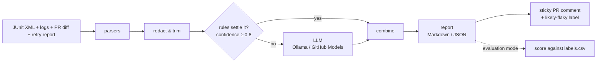

# FlakeHunter: project plan

## Summary
When CI goes red, engineers lose hours working out whether the product is broken, the test is unreliable, the environment failed, or the test itself is wrong. Teams that see too many false alarms start ignoring red builds, and real bugs slip through. FlakeHunter is for any team whose CI produces JUnit XML (pytest, Cypress, Jest, Selenium with Surefire or TestNG). It reads the failed run's JUnit reports, logs, retry results and the pull request diff, then posts one clear PR comment that gives each failing test a category, a confidence, the evidence lines and a next step. It decides with cheap deterministic rules first and sends only the unclear failures to a free open-source LLM: Ollama locally, GitHub Models in Actions using the built-in `GITHUB_TOKEN`. The project is done when v1.0.0 is tagged, a public demo PR shows a real comment, and an evaluation on 120+ labelled failures compares rules-only, LLM-only and combined.

## Categories
`product_bug`, `flaky_test`, `environment`, `test_code`, `unknown`. Definitions are in [categories.md](categories.md).

## Architecture



- **Rules first:** they're free, instant, deterministic and explainable (you can point at the exact pattern that matched).
- **LLM second:** it handles what rules can't read. It receives the rule hint as context and returns a JSON verdict validated against a schema.
- **Fail open:** any error in FlakeHunter logs a warning and exits 0. It never fails the user's build.

## Action type
A composite Action. See [DECISIONS.md](../DECISIONS.md#001--composite-action-instead-of-docker).

## Folder layout

```
src/flakehunter/
  models.py      # TestFailure, RuleHint, Verdict, Report (pydantic v2)
  config.py      # env vars / Action inputs → settings
  parsers/       # junit.py, logs.py, diff.py, retry.py
  rules.py       # data-driven rule list → RuleHint | None
  redact.py      # secret masking + trimming; single gate before the LLM
  llm.py         # Classifier protocol, OpenAI-compatible client
  combine.py     # rules + LLM → final verdict
  report.py      # Markdown / JSON rendering, hidden comment marker
  github.py      # PR diff, sticky comment, labels, fork detection
  cli.py         # `flakehunter analyze ...`
tests/           # unit tests + fixtures/
action.yml       # composite GitHub Action
examples/demo-app/  # FastAPI app with deliberate failures
data/README.md   # dataset download instructions (raw data never committed)
scripts/         # dataset fetchers, labelling tool
evals/           # labels.csv, run_evals.py, results.md
docs/            # plan, categories
```

The `src/` layout makes tests import the installed package rather than the local folder, which catches packaging mistakes early. Each pipeline stage is one module, so each stage can be tested on its own.

## Data models (sketch)

```
TestFailure   id, suite, name, classname?, file?, kind (failure|error),
              message, details, stdout?, duration_s?, source_format
RuleHint      rule, category, confidence (0–1), evidence: list[str]
Verdict       category, confidence (0–1), likely_cause, evidence: list[str],
              suggested_next_step, related_changed_files: list[str]
FinalVerdict  Verdict + failure_id, decided_by (rules|llm|combined|fallback), rule?
Report        verdicts, total_failures, skipped_count, tokens_in, tokens_out,
              elapsed_s, secrets_masked, provider, model
```

`id` is stable (`classname::name`), so failures can be joined to retry results, eval labels and comment rows.

## Milestones
M0 Plan · M1 Repo setup · M2 Parsing · M3 Rules · M4 Redaction · M5 LLM · M6 CLI · M7 GitHub integration · M8 Demo app · M9 Dataset & evals · M10 Release. Each milestone is one PR, merged only when CI is green.

## Open questions
1. **GitHub Models model ID:** which open-weight Llama model, with its exact ID? Check the catalog at the start of M7, and make it an Action input with a default.
2. **Structured output support:** does the chosen GitHub Models model accept `response_format: json_schema`, or only `json_object`? Make the format configurable with a fallback.
3. **Retry reports:** the simplest portable form is a second JUnit file from re-running only the failed tests (`pytest --lf`, Cypress `retries`, Surefire `rerunFailingTestsCount`). Confirm this in M3.
4. **Where the comment is posted from:** the same job with `if: failure()` (simple, but fork PRs have a read-only token), or a separate `workflow_run` workflow (works for forks, but is more complex)? Start with the same job and skip forks.
5. **Failure history on `main`:** worth adding in v1, or leave it for "what's next"? This is optional and deferred.
6. **Default local model:** `llama3.2:3b` for an 8 GB Mac; compare it with `llama3.1:8b` in M9.
